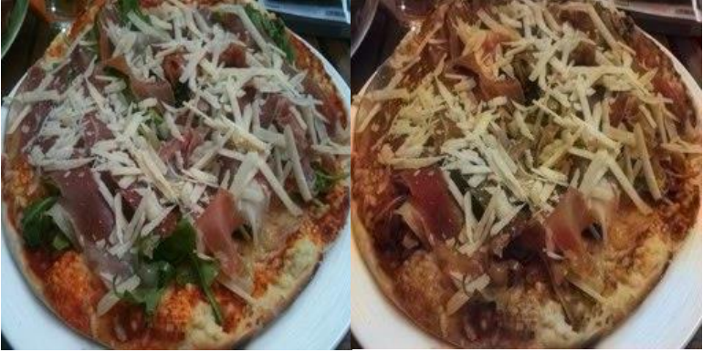

# Chromatica

Research code for image colorization, architecture comparison, and color
distribution analysis on Food-101 and COCO. Models predict the a*/b* channels of
CIE-Lab from lightness L*. The research asks how architecture and training data
affect reconstruction error, chroma, hue distributions, and directional color bias.

Mikhail Polevoda developed the models, experiment workflows, and color analysis
tools in this repository. The related publications were coauthored with
I. V. Lezina; software authorship and publication authorship are listed separately.

**Results status:** published 2025 measurements and one historical illustration
are preserved below. Historical ClearML datasets, checkpoints, and raw outputs
are considered lost. This revision has not executed training, evaluation,
notebooks, tests, or builds. The published numbers have not been revalidated
with the corrected code; new experiments are outside this revision's scope.

## Published measurements (2025)

| Published experiment | Data scope | Reported MSE | Source page |
| --- | --- | ---: | ---: |
| Initial network without skips | Pizza-only Food-101 experiment; 250 test images | ≈0.0159 | April paper, 1742 |
| Network without skips | 10 Food-101 classes; 15 epochs | 0.01313 | U-Net paper, 283 |
| Network with skips | Same 10 classes; 15 epochs | 0.0126 | U-Net paper, 285 |
| Skips + simulated classifier | Same 10 classes; 15 epochs | 0.01265 | U-Net paper, 286 |

These are MSE values as reported in the [publications](#publications), with
their original precision. They are not current physical Lab MAE/RMSE or a
reproduction using the four three-epoch configuration templates. The simulated
classifier supplies the correct class rather than learning to predict it; this
third historical variant is not implemented in the current package.

The color-diversity abstract (p. 68) reports a red-sector fraction of approximately
0.269 in originals and 0.314 in predictions of one model, with a ratio of about
1.17. Dataset/checkpoint attribution and compatibility with the corrected
metrics are unavailable. The [full published-results record](reports/published-results.md)
includes per-class MSE, signed-bias ranges, source hashes, and limitations;
an [HTML report](reports/published-results.html) is readable without running code.
The [reporting protocol](reports/README.md) describes any future deliberate runs.

## Published illustration (2025)



Original on the left; historical colorization on the right. Figure 2, p. 1742,
from the [2025 paper by М. А. Полевода and И. В. Лёзина](https://college.cfuv.ru/wp-content/uploads/2025/05/sbornik-czsm-2025.pdf#page=1742).
This is an excerpt from the publication, not a new run of the current code or a
comparison of the two architectures. Checkpoint and source-image identities are
unavailable. [Extraction provenance](reports/examples/published-colorization-2025.json)
records the source, page, and hashes.

## Architectures

| Configuration name | Historical name | Skip connections | Output activation |
| --- | --- | --- | --- |
| `encoder_decoder` | `v1`, `U_NET_WITHOUT_SKIP_CONNECTIONS` | None | Tanh |
| `unet` | `v2`, `U_NET_WITH_SKIP_CONNECTIONS` | Concatenation | ReLU |

Historical convolution, batch-normalization, and parameter-key layouts are
preserved. These are the project's U-Net-like networks. Their output activations
also differ, so an observed difference cannot be attributed to skip connections
alone. The ReLU model cannot emit negative normalized a*/b* coordinates.

Both accept `(N, 1, H, W)` and return `(N, 2, H, W)`; single-image tensors are also
supported. Spatial dimensions must be at least eight and divisible by eight.
Legacy imports under `chromatica.nn.v1/v2` and raw tensor state dictionaries remain
supported. Loading a legacy dictionary requires an explicit architecture name;
its training provenance remains unknown. Full pickled model objects are unsupported.

## Local workflow

Use Python 3.12 and [uv](https://docs.astral.sh/uv/). The following commands are
instructions for a future deliberate run; they have not been executed to validate
this revision. The local workflow needs no HTTP server, database, container, or
ClearML account.

Install the package and development tools:

```sh
uv sync --locked --extra cpu --group dev
```

On Linux, `cpu` selects CPU-only PyTorch 2.7 wheels. For a separately planned
CUDA 12.6 run, substitute `--extra cuda`; the extras are mutually exclusive.
macOS uses platform PyTorch wheels, with CPU as the default runtime device.
After selecting dependencies with `uv sync`, commands below use `--no-sync`
to retain that selection; resync deliberately when changing dependencies.
Set `device = "mps"` or `"cuda"` explicitly only on supported hardware. AMP is
opt-in and restricted to CUDA. Deterministic mode may reject unsupported
operations; there is no silent device fallback.

Small engineering checks, when execution is authorized:

```sh
uv run --no-sync chromatica-smoke
uv run --no-sync pytest tests
```

Smoke uses synthetic 16×16 CPU tensors and one optimization step per architecture;
it produces no research evidence. Tests cover transforms, channel pairing, known
physical bias, short batches, dataset discovery, palettes, shapes, and checkpoints.

Provide local images in separate training and held-out test directories:

```text
.data/food101/train/<class>/<image>.jpg
.data/food101/test/<class>/<image>.jpg
.data/coco/train/<image>.jpg
.data/coco/test/<image>.jpg
```

Filenames and class sizes may vary. Images are decoded as RGB on CPU, resized to
the configured square shape with bilinear antialiasing, and converted to normalized
Lab. Validation is drawn only from training images using the recorded seed. Keep
official test inputs separate and preserve dataset release/split information when
arranging local files. TOML paths are relative to the command's working directory;
run commands from the repository root.

Four [configuration templates](configs/) cover both architectures and datasets.
Their three-epoch budgets are unexecuted examples, not tuned settings or
reproductions of published results. Each run creates a fresh model and refuses
to overwrite an existing output directory.

To train and evaluate all four configurations sequentially and save standalone
HTML results, run from the repository root:

```sh
uv sync --locked --extra cpu
uv run --no-sync chromatica-run-all
```

Obtain the local train/test images above before starting. Review the device,
epoch budget, and batch limits in each configuration. This command trains four
fresh models; it is a research run, not an environment check. It first checks
all split directories, image discovery, devices, and output collisions.
The implementation has only been statically checked, not executed.

On a compatible Apple Silicon Mac, explicitly select the GPU with
`uv run --no-sync chromatica-run-all --device mps`. This overrides the device
in all four configs and records the selected device in run metadata.
MPS availability and runtime compatibility have not been verified for this code.

The final summary is `reports/index.html`; individual results are
`reports/food101_encoder_decoder.html`, `reports/food101_unet.html`,
`reports/coco_encoder_decoder.html`, and `reports/coco_unet.html`.
They include metric tables, original/prediction hue histograms with eligible
counts, training history, limits, and provenance. HTML is self-contained and
requires neither Jupyter nor ClearML. This run does not generate the notebook's
additional mode palettes or a curated prediction-image gallery.
Checkpoints, full manifests, history, and evaluation JSON remain in `.runs/`.
An existing run directory or target HTML stops the command before training;
a later runtime failure preserves already completed runs and individual HTML,
but does not produce a completed summary.

For a single, explicitly requested experiment:

```sh
uv run --no-sync chromatica-train --config configs/food101_encoder_decoder.toml
uv run --no-sync chromatica-train --config configs/food101_unet.toml
uv run --no-sync chromatica-evaluate --config configs/food101_encoder_decoder.toml \
  --checkpoint .runs/food101_encoder_decoder/checkpoint.pth \
  --output .runs/food101_encoder_decoder/evaluation.json
uv run --no-sync chromatica-evaluate --config configs/food101_unet.toml \
  --checkpoint .runs/food101_unet/checkpoint.pth \
  --output .runs/food101_unet/evaluation.json
uv run --no-sync chromatica-compare \
  .runs/food101_encoder_decoder/evaluation.json \
  .runs/food101_unet/evaluation.json --output .runs/food101_comparison.csv
```

Repeat with COCO configurations as independent runs. Cross-dataset transfer
requires an explicitly chosen checkpoint and separate held-out dataset report.
Tables require matching test-file hashes, image size, metric version, and evaluation
settings. Rows flag whether recorded training protocols match and retain hashes.
Review training provenance and match seeds, split manifests,
optimization budgets, and preprocessing before interpreting architecture effects.
Use multiple seeds to estimate uncertainty.

Run directories contain configuration/environment metadata, file hashes, split
membership, training history, tensor checkpoints, and evaluation reports.
Checkpoint loading uses `weights_only=True` with strict parameter matching.
Keep data, weights, caches, and bulk outputs outside Git. Curated figures and
examples can be added after producing and reviewing actual results.

The synthetic smoke path is intended for CPU; full datasets require separate compute
and storage planning. GPU memory depends on image size, batch size, and architecture.
No memory, throughput, or runtime benchmark is available. `max_train_batches`,
`max_val_batches`, and evaluation `max_batches` explicitly bound exploratory runs;
limited reports must not be presented as full-dataset results.

## Color units and metrics

The checkpoint-compatible encoding is:

```text
L_normalized  = L* / 100
ab_normalized = (ab* + 128) / 127.5 - 1
ab*           = 127.5 * ab_normalized - 0.5
```

Descriptive color metrics decode physical a*/b* first. Channel pairs preserve
each pixel's a*/b* across images and noncontiguous tensors. Predictions must match
target shapes exactly; evaluation never resizes them to conceal a contract mismatch.

Signed `mean_delta_a` and `median_delta_a` describe red/magenta versus greenward
bias. MAE/RMSE quantify error separately; `mae_ab` and `rmse_ab` average the two
chroma-channel errors and are not perceptual ΔE. Chroma, hue counts, red-sector
fractions, and red angular imbalance describe distributions; they cannot alone
establish increased diversity or improved quality.

Hue excludes zero-chroma pixels and applies a physical chroma threshold
independently to targets and predictions. Report both eligible populations.
Median delta-a is a histogram estimate with explicit bin width and tail counts;
it is undefined when central order statistics fall outside its range. JSON records
undefined metrics as `null`. RGB gamut clipping is limited to visualization;
physical Lab errors use unclamped predictions.

Grid palettes reject colors outside their physical range. K-means uses a bounded
sample without duplicating pixels; percentages describe that sample. Publish
palette thresholds, eligible populations, sampling settings, and algorithm.

## Notebooks and optional ClearML

Install notebook dependencies and start Jupyter from the repository root:

```sh
uv sync --locked --extra cpu --group notebook
scripts/lab.sh
```

The four notebooks contain research questions, protocols, interpretation, and
limitations. Analysis/training gates default to `False`; opening them starts no
experiment. Shared computation lives in the package.

Notebooks combine the research narrative with interactive exploration, plots,
and interpretation. They import package functions rather than execute Python
files as wrappers. The CLI supports unattended training and evaluation; notebooks
remain useful for investigating and explaining the resulting reports.

ClearML remains optional for tracking, dataset IDs, and checkpoint artifacts.
Add `--extra clearml` to the selected installation command. Configure credentials
using ClearML's user-level configuration or environment outside the repository.
Set `[tracking].enabled = true` deliberately to create a task and upload checkpoint
and metadata. For a new ClearML dataset, omit local split paths and set
`clearml_dataset_id`, `train_subdir`, and `test_subdir`. Explicit retrieval is available
through `chromatica.integrations.clearml.checkpoint_artifact(task_id, artifact_name)`.
No historical artifact is required or assumed available.

## Publications

Original Russian records are retained without invented DOI or translated venue
names. Authors, year, volume, and pages are corroborated by the
[Samara University publication list](https://ssau.ru/staff/99508184-lezina-irina-viktorovna).
Full author names, publishers, publication places, ISBNs, and conference dates
were supplied from the author's Zotero records.
See [publications.bib](publications.bib); cite the software separately with
[CITATION.cff](CITATION.cff).

1. М. А. Полевода, И. В. Лёзина. **Исследование цветового разнообразия в
   изображениях и моделях колоризации.** XXVI Всероссийская конференция молодых
   учёных по математическому моделированию и информационным технологиям:
   тезисы докладов. Новосибирск: Федеральный исследовательский центр
   информационных и вычислительных технологий, 2025. С. 68.
   ISBN 978-5-905569-30-2. Конференция: 10–14 ноября 2025 г.
   [Издание](https://expose.gpntbsib.ru/expose/elektronnye-materialy-nauchnyh-meropriyatiy-popolnenie-bazy-dannyh-nauchnye-meropriyatiya-ran-mart-2026-g.-686ea540/book/27-506801874).
2. М. А. Полевода, И. В. Лёзина. **Применение нейронной сети U-Net и её
   модификаций для решения задачи колоризации изображений.** «Автоматизированные
   системы управления и информационные технологии». Пермь: Издательство
   Пермского национального исследовательского политехнического университета,
   2025. Т. 2. С. 282–288. ISBN 978-5-398-03378-6.
   Конференция: 5–7 июня 2025 г.
   [Каталог](https://cat.gpntb.ru/?id=EC%2FShowFull&irbDb=I128F&mfn=52111).
3. М. А. Полевода, И. В. Лёзина. **Исследование применения свёрточных нейронных
   сетей для решения задачи колоризации изображений.** «Цифровые системы и модели:
   теория и практика проектирования, разработки и использования».
   Казань: Казанский государственный энергетический университет, 2025.
   С. 1739–1743. ISBN 978-5-89873-689-7. Конференция: 10–11 апреля 2025 г.
   [Сборник](https://college.cfuv.ru/wp-content/uploads/2025/05/sbornik-czsm-2025.pdf).

## License and data sources

Original code is available under [MIT](LICENSE). Images and third-party materials
retain their own terms; the software license grants no dataset redistribution
rights. Obtain images from [Food-101](https://data.vision.ee.ethz.ch/cvl/datasets_extra/food-101/)
and [COCO](https://cocodataset.org/#download), and review source terms before
selecting public examples.

## Development

The [CI workflow](.github/workflows/ci.yml) prepares Linux CPU dependencies, Ruff,
deterministic CPU tests, and wheel build/install checks. It is configured but has
not run for this revision. Static checks do not establish runtime correctness.

```sh
uv run --no-sync ruff format src tests scripts notebooks
uv run --no-sync ruff check src tests scripts notebooks
uv run --no-sync pytest tests
uv build
```
